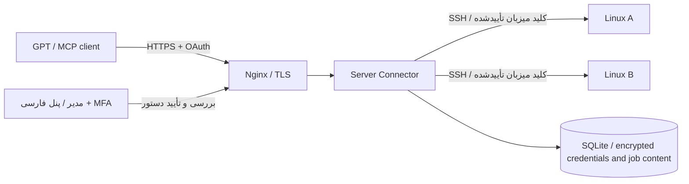

# مدار — Server Connector

درگاه مدیریت چند سرور لینوکسی از طریق SSH، با پنل فارسی و ابزارهای MCP برای GPT.



واسط باید داخل شبکه‌ای باشد که به IP سرورها دسترسی دارد. GPT به endpoint استاندارد MCP وصل می‌شود؛ اتصال SSH را واسط برقرار می‌کند. برای این کار به OpenAI API Key نیاز نیست. ورود GPT با OAuth و حساب همین سامانه انجام می‌شود. رمز SSH، کلید خصوصی و رمز پنل را داخل گفتگو با GPT ارسال نکنید.

## امکانات پیاده‌سازی‌شده

- پنل فارسی واکنش‌گرا: سرورها، کاربران، مجوزها، صف کار، تأیید دستور، خروجی، رخدادها و لغو اتصال GPT.
- نقش‌های مدیر، اپراتور و ناظر؛ مجوز مستقل عیب‌یابی و درخواست دستور برای هر کاربر و هر سرور.
- ورود با رمز هش‌شده با scrypt و TOTP؛ تأیید دو مرحله‌ای در production اجباری است.
- ورود SSH با رمز یا کلید خصوصی دارای عبارت عبور؛ رمزگذاری AES-256-GCM با کلید اصلی خارج از دیتابیس.
- بررسی اجباری اثر انگشت SHA256 میزبان، مقصدهای IP ثابت و محدودیت CIDR؛ بدون پذیرش خودکار کلید یا agent forwarding.
- پنج عیب‌یابی ثابت بدون ورودی shell؛ تمام دستورهای آزاد، حتی درخواست مدیر از MCP، نیازمند تأیید انسانی در پنل هستند.
- صف پایدار با شناسهٔ تکرارناپذیری، انقضای تأیید، محدودیت زمان، حجم خروجی، هم‌زمانی و یک کار هم‌زمان برای هر سرور.
- بازبینی مجوز هنگام اجرا و هر ۵۰۰ میلی‌ثانیه در طول اجرا؛ تغییر مقصد یا کلید، تأییدهای قبلی را بی‌اعتبار می‌کند.
- OAuth Authorization Code + PKCE S256، ثبت پویا با DCR، discovery، بررسی resource، چرخش refresh token و ابطال خانواده در صورت استفادهٔ مجدد.
- ثبت رخداد بدون متن دستور و اسرار، با زنجیرهٔ HMAC؛ متن دستور، هدف و خروجی کارها در دیتابیس رمزگذاری می‌شوند.
- نصب‌کنندهٔ خودکار Docker، Nginx، Certbot و HTTPS، اجرای برنامه با کاربر غیر root و بدون انتشار مستقیم پورت برنامه.

## اجرای محلی

Node.js نسخهٔ ۲۰٫۱۹ به بالا یا ۲۲ و npm لازم است. برای نصب روی سرور، Node.js ۲۲ را انتخاب کنید.

```sh
npm ci
node scripts/setup-local.mjs
```

فایل `.env` را ویرایش کنید و `SSH_ALLOWED_CIDRS` را به IP یا شبکهٔ واقعی سرورها محدود کنید. سپس:

```sh
npm run admin -- create-admin admin
npm run build
npm start
```

دستور ساخت مدیر، رمز را مخفی دریافت می‌کند. کلید MFA یک بار فقط در ترمینال نمایش داده می‌شود؛ آن را به Authenticator اضافه کرده و کد جاری را وارد کنید. در ورود بعدی از کد تازه استفاده کنید. هیچ حساب یا رمز پیش‌فرضی وجود ندارد.

پنل: `http://localhost:3080`. نسخهٔ HTTP محلی برای اتصال میزبانی‌شدهٔ GPT کافی نیست؛ endpoint باید از محل اجرای کلاینت GPT قابل دسترس باشد.

## نصب خودکار روی سرور واسط

فایل ZIP را روی یک میزبان **Ubuntu 22.04/24.04 یا Debian 12/13 با systemd** باز کنید و از داخل پوشهٔ سورس اجرا کنید:

```sh
sudo bash script.sh
```

نیازی به نصب دستی Node.js، Docker، Nginx یا نوشتن تنظیمات پراکسی نیست. دامنهٔ پیش‌فرض `server.darvishipioneers.com` و callback استاندارد GPT از قبل تنظیم شده‌اند. در اولین اجرا، اسکریپت ایمیل گواهی و شبکه‌های مجاز SSH را دریافت می‌کند. برای حساب مدیر هم رمز مخفی و تأیید MFA می‌گیرد. در اجرای دوباره از تنظیمات، کلید اصلی، حساب‌ها و volume موجود استفاده می‌کند.

قبل از اجرا، رکورد DNS دامنه را به IP این میزبان متصل کنید؛ TCP 80 و 443 نیز باید در فایروال ارائه‌دهندهٔ سرور قابل دسترس باشند. نصب‌کننده قواعد لازم را به UFW یا firewalld **از قبل فعال** اضافه می‌کند. این اسکریپت به حساب DNS یا فایروال ابری شما دسترسی ندارد.

اسکریپت این مراحل را انجام می‌دهد:

1. نصب ابزارهای پایه و Docker Engine/Compose از مخزن رسمی دارای `Signed-By`، در صورت نبودن آن‌ها؛ بدون حذف بسته‌های سرویس‌های دیگر.
2. انتخاب پورت محلی و شبکهٔ Docker بدون تداخل با مسیرها و شبکه‌های مقصد؛ تولید `.env` و کلید اصلی خصوصی بدون نمایش کلید در خروجی.
3. ساخت image همراه با تست‌های برنامه، اجرای gateway و بررسی health؛ سپس ساخت مدیر با رمز مخفی و MFA فقط وقتی مدیر فعال وجود ندارد.
4. نصب Nginx و Certbot، پیکربندی مسیرهای پنل، `/mcp`، `/oauth/*` و `/.well-known/*`؛ gateway فقط روی `127.0.0.1` منتشر می‌شود.
5. دریافت HTTPS با webroot از Let's Encrypt پس از موافقت شما با شرایط صدور، فعال‌سازی تمدید زمان‌بندی‌شده و hook بارگذاری مجدد Nginx؛ اجرای آزمون تمدید.
6. بررسی HTTPS، OAuth discovery و دسترسی با DNS عمومی؛ فقط در صورت موفقیت مراحل، پیام اتمام نصب نمایش داده می‌شود.

پس از اتمام، پنل `https://YOUR_DOMAIN` و نشانی MCP برابر `https://YOUR_DOMAIN/mcp` است. خودکار بودن نصب، دریافت fingerprint و مجوز معتبر SSH از مالک هر مقصد را جایگزین نمی‌کند؛ آماده‌سازی مقصدها در بخش بعد آمده است.

راهنمای جزئیات، رفتار خطا و اجرای دوباره در [docs/INSTALL.md](docs/INSTALL.md) است. تنظیمات Nginx در `deploy/nginx-http.conf.in` و `deploy/nginx-https.conf.in` نگه‌داری می‌شوند. روش نصب مطابق [راهنمای رسمی Docker](https://docs.docker.com/engine/install/ubuntu/) و [راهنمای Certbot webroot و renewal](https://eff-certbot.readthedocs.io/en/stable/using.html) تنظیم شده است.

فایل پایهٔ Compose همچنان پروفایل اختیاری `caddy` را برای روش قبلی دارد؛ نصب‌کننده فقط gateway و **Nginx میزبان** را اجرا می‌کند. اگر Caddy همین پروژه قبلاً اجرا شده باشد، اسکریپت آن را با حفظ داده‌ها به Nginx منتقل می‌کند. سایت‌های دیگر Nginx یا کانتینرهای دیگر متوقف نمی‌شوند. پروژه باید با **یک replica** و دیسک محلی اجرا شود.

## آماده‌سازی هر سرور Linux

۱. یک کاربر اختصاصی مثل `gptops` با کمترین مجوز لازم ایجاد کنید. برنامه ورود مستقیم با نام `root` را رد می‌کند. به این کاربر عضویت Docker، sudo کامل یا دسترسی خواندن فایل‌های محرمانه ندهید، مگر عمداً همان سطح اختیار را می‌خواهید؛ Docker معمولاً معادل اختیار root است.

۲. روی واسط، یک کلید اختصاصی دارای عبارت عبور برای هر مقصد ایجاد کنید و فقط public key را در `authorized_keys` کاربر مقصد قرار دهید. private key و passphrase را در فرم سرور پنل وارد کنید. رمز SSH نیز پشتیبانی می‌شود؛ کلید اختصاصی برای هر مقصد انتخاب مناسب‌تری است.

۳. در `authorized_keys` از قید `restrict` و `from="GATEWAY_SOURCE_IP"` استفاده کنید تا forwarding، PTY و اتصال از مبداهای دیگر محدود شوند. IP مبدا را از دید مقصد، پس از NAT یا VPN، تعیین کنید. فایروال مقصد نیز SSH را به همان مبدا محدود کند. نمونهٔ زیر جایگزین تنظیمات واقعی نیست:

```text
restrict,from="10.20.0.2" ssh-ed25519 PUBLIC_KEY_HERE connector-to-server-a
```

۴. روی کنسول معتبر **خود مقصد**، اثر انگشت را دریافت کنید:

```sh
ssh-keygen -lf /etc/ssh/ssh_host_ed25519_key.pub -E sha256
```

برای مشاهدهٔ همهٔ کلیدهای فعال میزبان، همین دستور را برای فایل‌های public key دیگر نیز اجرا کنید. فقط مقدار `SHA256:...` را در پنل وارد کنید؛ کلیدی که سرویس SSH هنگام مذاکره ارائه می‌کند باید دقیقاً همان fingerprint را داشته باشد. `ssh-keyscan` بدون مقایسه با منبع معتبر، هویت سرور را اثبات نمی‌کند.

۵. مقصد باید `/bin/sh` و GNU `timeout` از coreutils داشته باشد. ابزارهای `uname`، `uptime`، `df` و `free` برای عیب‌یابی لازم‌اند؛ `systemctl` فقط در مقصدهای دارای systemd کاربرد دارد.

۶. در پنل سرور را اضافه کنید؛ سپس یک عیب‌یابی «سیستم‌عامل» ثبت کنید و خروجی واقعی آن را بررسی کنید. ثبت تنظیمات به معنای موفق بودن اتصال نیست. پنل تا زمان اجرای کار، سرور را «اتصال بررسی نشده» نشان می‌دهد.

## اتصال به GPT Work / ChatGPT با یک URL

نشانی این نصب بعد از اجرای موفق `script.sh`:

```text
https://server.darvishipioneers.com/mcp
```

در **Plugins → + → Add custom MCP server** همین URL را وارد کنید. OAuth و ثبت خودکار کلاینت از خود سرور کشف می‌شوند؛ Client ID، Client Secret یا کلید SSH دستی لازم نیست. در صفحهٔ مرورگر یک بار با حساب مدیر و MFA وارد شوید و اجازهٔ اتصال را تأیید کنید، سپس `Create as a plugin` را کامل کنید. در گفتگوی تازه، پلاگین را با `@` انتخاب کنید. [راهنمای رسمی اتصال](https://developers.openai.com/plugins/deploy/connect-chatgpt)

نشانی دامنه و callback پایدار GPT در تنظیمات نصب پیش‌فرض شده‌اند. مدیر با رضایت `gateway:manage` به ۱۸ ابزار مدیریت سرورها، نقش و مجوزهای کاربران، کارها، رخدادها و اتصال‌ها دسترسی دارد. حساب‌های محدود فقط ابزارها و سرورهای مجاز خود را دارند. رمزها، MFA و کلیدهای خصوصی از صفحهٔ امن پنل مدیریت می‌شوند؛ دستور آزاد همچنان تأیید انسانی می‌خواهد.

اتصال OAuth مستقل از نشست مرورگر است و در استفادهٔ عادی خودکار تمدید می‌شود. access token ده‌دقیقه‌ای و refresh token با مهلت عدم فعالیت ۹۰روزه دارد؛ هر تمدید موفق مهلت تازه می‌دهد. لغو اتصال، تغییرات امنیتی حساب یا ۹۰ روز عدم فعالیت نیاز به ورود مجدد دارد.

جزئیات ۱۸ ابزار، محدودیت‌های امنیتی و آزمون اتصال واقعی در [docs/MCP_CONNECTION.md](docs/MCP_CONNECTION.md) آمده است. `requestKey` هر اجرای کار UUID است؛ برای retry همان درخواست از همان UUID و برای کار تازه از UUID تازه استفاده کنید.

## نگه‌داری و بازیابی

- از کلید اصلی و دیتابیس، **جداگانه و امن** نسخهٔ پشتیبان بگیرید. از دست رفتن کلید به معنی از دست رفتن امکان رمزگشایی کلیدهای SSH و محتوای کارها است. کلید روی راه‌اندازی مجدد باید ثابت بماند.
- پشتیبان آنلاین را با `node dist/cli.js backup /app/data/backup.sqlite` بسازید، یا سرویس gateway را متوقف کنید و سپس volume را کپی کنید. کپی کردن فقط فایل SQLite در حال اجرا بدون WAL، پشتیبان قابل اعتماد نمی‌سازد.
- برای بازیابی رمز یا MFA: `node dist/cli.js reset-account USER` را در ترمینال امن میزبان یا `docker compose exec gateway ...` اجرا کنید. نشست‌ها و توکن‌های قبلی آن حساب بی‌اعتبار می‌شوند.
- برای بررسی امضا: `node dist/cli.js verify-audit`. خروجی `checkpoint` را بیرون میزبان نگه دارید تا حذف انتهای زنجیره هم قابل بررسی باشد. دیتابیس، زنجیره را در برابر مدیر سیستم دارای کلید اصلی مصون نمی‌کند.
- محتوای کارهای پایان‌یافته پس از `RETENTION_DAYS` به‌صورت دوره‌ای حذف می‌شود؛ رخدادهای بدون متن دستور باقی می‌مانند. شناسه‌های تکرارناپذیری هم پس از حذف کار حفظ نمی‌شوند. بعد از پایان دورهٔ نگه‌داری، UUID قدیمی را دوباره ارسال نکنید.
- لغو OAuth، درخواست‌های بعدی آن اتصال را مسدود می‌کند. برای توقف کارهای از قبل ثبت‌شده، خود کار را لغو کنید؛ غیرفعال‌کردن حساب یا سرور، کارهای در صف و در حال اجرا را نیز متوقف می‌کند.
- پس از قطع سرویس هنگام اجرا، کار `interrupted` می‌شود و خودکار تکرار نمی‌شود. در `remoteState: unknown` مقصد را قبل از هر تکرار بررسی کنید. بستن کانال SSH، توقف قطعی همهٔ فرایندهای جداشده را تضمین نمی‌کند.

جزئیات مرزهای امنیتی و محدودیت‌ها در [docs/SECURITY.md](docs/SECURITY.md) است.

## بررسی و بسته‌بندی

```sh
npm run check
npm run test:cli
npm run test:installer
npm audit --omit=dev --audit-level=high
python3 scripts/package.py
```

بستهٔ `artifacts/server-connector.zip` از allowlist ساخته می‌شود و شامل source، lockfile، تست‌ها، راهنما و تنظیمات نمونه است؛ `.env` واقعی، کلید، دیتابیس و `node_modules` در آن قرار نمی‌گیرد.

آزمون CLI از Python 3 و PTY در Linux/macOS استفاده می‌کند و production build را هم انجام می‌دهد. ساخت image همین آزمون را اجرا می‌کند.

گزارش تفکیک تست محلی، SSH آزمایشی، بررسی مرورگر و محدودیت استقرار در [docs/VALIDATION.md](docs/VALIDATION.md) ثبت شده است. برای استفاده روی سرور واقعی، مشخصات شبکه، اثر انگشت معتبر، حساب Linux و دامنه باید توسط مالک زیرساخت تنظیم شوند.
# drv_ssh_manager
